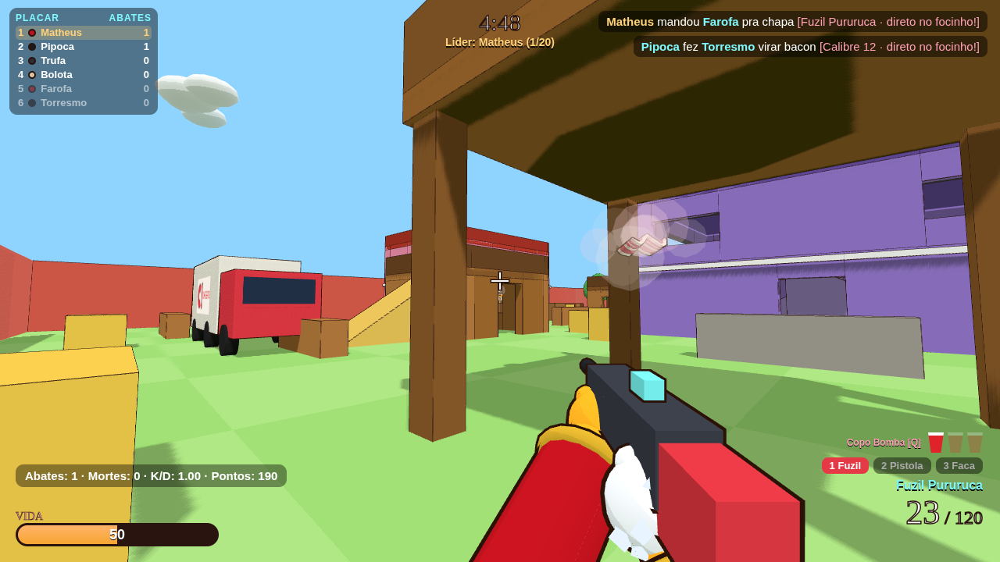
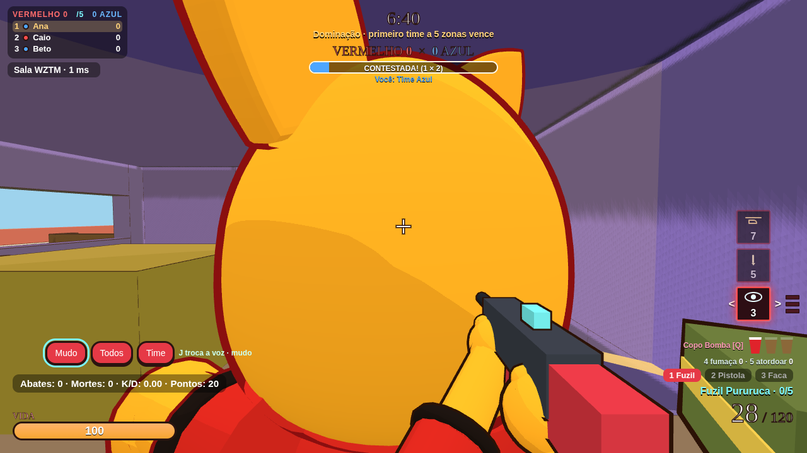
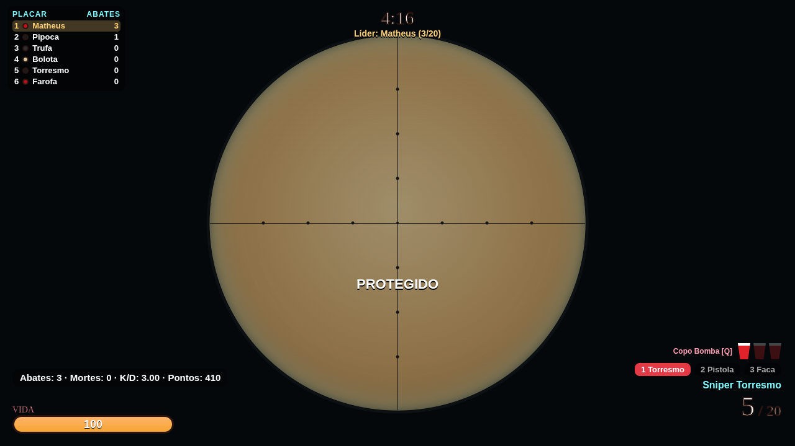
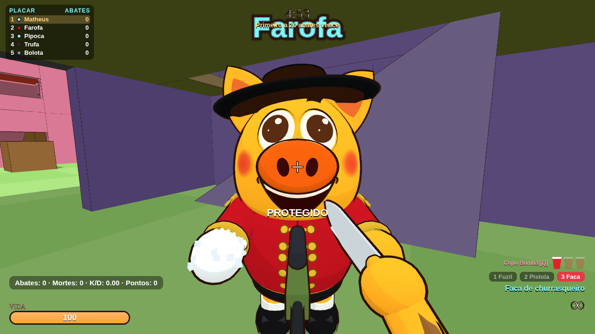
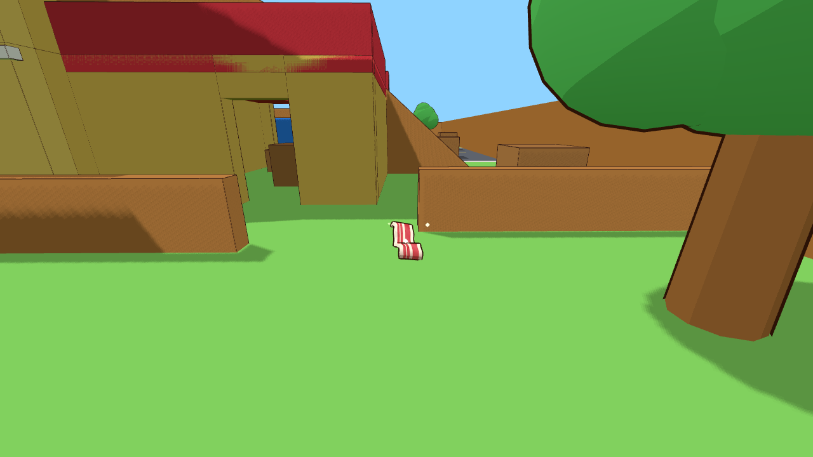
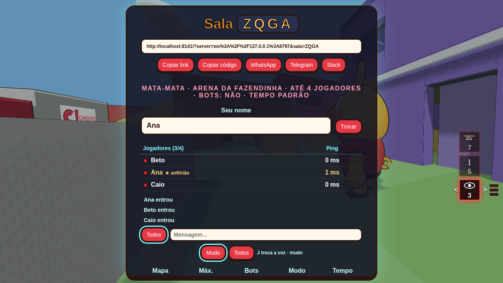

<div align="center">

# 🐷🔫 Docão Shooter

### Tiroteio na Fazendinha Cheers

**FPS no navegador em que todo mundo é o Docão, o porquinho mascote da Cheers.**
Quem morre vira bacon 🥓 e o bacon cura quem pisar nele.

[](https://docao.mvalentim.dev)
[](https://github.com/valentimm/docao-shooter/releases/latest)

[](https://threejs.org)
[](https://workers.cloudflare.com)
[](https://docao.mvalentim.dev)
[](https://playwright.dev)



</div>

Tudo foi feito do zero: os modelos são procedurais em Three.js, os sons são sintetizados com WebAudio e não há código, arte, nome ou áudio de terceiros. Abra o link, escolha a skin e comece a pururucar. Não precisa instalar nem criar conta: dá pra jogar sempre como **convidado**. Se quiser, crie uma **conta opcional** pra ter apelido fixo, ranking e skin guardada.

---

## 📚 Sumário

- [🎮 Como jogar](#-como-jogar)
- [👤 Conta e ranking](#-conta-e-ranking)
- [⌨️ Controles](#️-controles)
- [🏆 Modos de jogo](#-modos-de-jogo)
  - [🎃 Invasão · Hordas de Zumbis](#-invasão--hordas-de-zumbis)
  - [💣 Bomba · Planta o Botijão](#-bomba--planta-o-botijão)
- [🗺️ Mapas](#️-mapas)
- [🔫 Armas](#-armas)
- [💣 Granadas](#-granadas)
- [🔥 Killstreaks e camuflagens](#-killstreaks-e-camuflagens)
- [❤️ Mecânicas](#️-mecânicas)
- [🎭 Skins](#-skins)
- [📸 Galeria](#-galeria)
- [💻 Rodando localmente](#-rodando-localmente)
- [🧪 Testes](#-testes)
- [🗂️ Estrutura do projeto](#️-estrutura-do-projeto)
- [⚙️ Por dentro do online](#️-por-dentro-do-online)
- [🤝 Como contribuir](#-como-contribuir)
- [⚠️ Limitações conhecidas](#️-limitações-conhecidas)
- [🙌 Créditos](#-créditos)

---

## 🎮 Como jogar

1. Abra **https://docao.mvalentim.dev**.
2. Escreva **seu nome** (até 16 caracteres) e escolha a **skin** do Docão.
3. Monte o loadout: **uma arma de cada categoria** (primária, secundária e corpo a corpo). Se for de Sabre de Luz, escolha a cor dele também.
4. Escolha o **mapa** (ou **Aleatório**, que sorteia um mapa a cada partida) e o **modo**.
5. Clique em **JOGAR OFFLINE** ou em **JOGAR ONLINE**.

O nome, a skin, as armas, a dança da vitória, o mapa, o modo, a dificuldade dos bots e a sensibilidade ficam salvos no navegador. Com uma conta, o apelido e a skin ficam guardados no servidor (veja [Conta e ranking](#-conta-e-ranking)).

### 🤖 Offline (contra bots)

- De **4 a 6 bots**, cada um com nome de comida: Farofa, Pipoca, Trufa, Bolota, Torresmo, Paçoca, Linguiça, Quindim, Coxinha e Pururuca.
- Os bots ganham uma primária aleatória, escolhem a arma pela distância, pegam vida e Copo Bomba, arremessam granadas e sobem e descem andares pelas rampas.
- A **Dificuldade** (Leitão, Ceva, Javali ou Cachaço) muda como eles miram, reagem e se movem. A Ceva é o jeito antigo. A vida e o dano das armas não mudam. Na Invasão a mesma escolha mexe no cuspe e no cerco da horda, sem aumentar a vida das waves. A preferência fica salva no navegador.
- No menu também dá pra escolher o **Tempo** da partida e a **Sensibilidade** do mouse (normal e mirando).

### 🌐 Online (com a galera)

- **Criar sala:** escolha mapa, modo (Mata-mata, Dominação, Treino, Invasão ou Bomba), **máximo de jogadores (2 a 10)**, se quer **completar com bots**, a **dificuldade** deles (Leitão, Ceva, Javali ou Cachaço), o **tempo** (Padrão, 3, 5, 7, 10, 15 ou 20 min) e **quais armas e power-ups valem na sala** (o loadout da sala). Sai um **código de 4 letras**.
- **Entrar na sala:** digite o código ou abra o link de convite `https://docao.mvalentim.dev/?sala=ABCD`, que já cai direto no lobby.
- **Convite:** no lobby e na pausa tem Copiar link, Copiar código, WhatsApp, Telegram, Slack e Compartilhar.
- **Anfitrião (★):** troca mapa, máximo, bots, dificuldade, modo, tempo, as armas e os power-ups liberados e o **chat (liga/desliga)**, e clica em **INICIAR PARTIDA**. No fim, ele escolhe **JOGAR DE NOVO** ou **PRÓXIMO MAPA ▸**.
- **Armas da sala:** o dono libera ou bloqueia categorias de armas e power-ups (killstreaks, vida, munição, Copo Bomba, fumaça e pau de choque). Os bots só sacam armas que a sala permite, o lobby mostra o que ficou liberado e o menu lembra a sua arma padrão de cada categoria. Cada slot (primária, secundária e corpo a corpo) sempre fica com pelo menos uma arma.
- **Nomes repetidos:** o servidor ajusta sozinho, então o segundo "Matheus" vira "Matheus (2)". Se o apelido for de uma **conta**, quem não é o dono entra como "(conv)".
- **Caiu a conexão?** O jogo reconecta sozinho e você volta com o mesmo jogador e o mesmo placar.

---

## 👤 Conta e ranking

A conta é **opcional**: quem não quiser criar uma joga como **convidado**, exatamente como antes, sem e-mail nem perguntas.

- **Apelido fixo:** um apelido é de uma conta só (3 a 16 caracteres; letras, números, espaço, ponto, hífen e _). "Matheus", "matheus" e "Mathéus" contam como o mesmo apelido. Logado, o seu nome na sala é o da conta e não muda no meio do jogo. Quem tentar entrar com o apelido de outra pessoa vira "(conv)".
- **Skin salva:** a skin que você escolher volta quando você entrar de novo. Só vale **skin que já existe** no jogo. Convidado guarda a skin só no navegador.
- **Ranking:** abates, mortes, vitórias e partidas por modo (Mata-mata, Dominação, Bomba e Invasão), ordenado por abates ou por vitórias, no botão **Ranking** do menu. Só conta o que você joga **logado** e o **Treino não vale**.
- **Segurança:** senha com mínimo de 8 caracteres, guardada com **PBKDF2-SHA256** (nunca em texto puro) e sessão por **token** (só o hash fica no banco). Há limite de tentativas contra quem fica chutando senha, e a mensagem de erro não diz se errou o apelido ou a senha.
- **Banco:** as contas ficam num **Cloudflare D1** (`docao-contas`), ligado ao Worker pelo binding `DB`. As gravações do ranking são feitas em lote, só quando você sai da sala ou a partida acaba, e a lista do ranking fica 1 minuto em cache.
- **Sem D1, sem drama:** se o Worker estiver sem o binding `DB`, as rotas de conta respondem 503 e o jogo segue normal como convidado.

Como subir e testar isso está em [Deploy](#deploy) e em [`docs/LOGIN-DEPLOY.md`](docs/LOGIN-DEPLOY.md).

---

## ⌨️ Controles

| Tecla | O que faz |
|---|---|
| **W A S D** (ou setas) | andar |
| **Mouse** | mirar |
| **Espaço** | pular |
| **Shift** (segurar, esquerdo ou direito) | agachar: câmera e corpo abaixam, anda mais devagar; só levanta quando há espaço |
| **Clique esquerdo** | atirar · golpe da faca · corte do sabre · segurar = puxar a corda do arco |
| **Botão direito** | mirar com zoom (luneta nas snipers) · **com a faca na mão: estocada** |
| **R** | recarregar |
| **1** / **2** / **3** | primária / secundária / corpo a corpo |
| **Rodinha do mouse** | gira entre as três armas |
| **V** | troca rápida: faca ↔ última arma |
| **I** | inspecionar a arma (segure pra ficar olhando) · mostra camuflagem e abates |
| **Q** (segurar e soltar) | carrega e arremessa o **Copo Bomba** |
| **4** | granada de **fumaça** (só offline) |
| **5** | **pau de choque**: arremessa uma estaca elétrica (online e offline) |
| **F** | usa o **killstreak** pronto (o mais antigo primeiro). Não existe na Invasão |
| **E** (segurar) | Modo Bomba: **planta** o Botijão (Ataque, dentro do site) ou **desarma** (Defesa, perto dele) |
| **Tab** (segurar) | placar |
| **B** | **dança da vitória** em 3ª pessoa por uns 3 s (escolha o passo no menu ou na pausa; dançando você não atira). No Treino, na preparação da Bomba e na Invasão o B tem outra função (veja abaixo) |
| **H** | liga ou desliga as **vozes da granada** no meio da partida, com aviso na tela |
| `` ` `` (crase) | pausa leve: solta o mouse sem abrir o menu. Aperte de novo pra voltar |
| **Esc** ou **P** | pausa (no menu de pausa o botão **Vozes da granada** fica bem em destaque no topo) |

**Na tela de morte**

| Tecla | O que faz |
|---|---|
| **1 – 9** (ou clique no cartão) | escolhe a primária do próximo renascimento, na ordem da lista (as armas liberadas pela sala): 1 Fuzil Pururuca · 2 Commando da Granja · 3 MP5K da Granja · 4 P90 da Granja · 5 FAMAS da Pocilga · 6 Calibre 12 · 7 Sniper Torresmo · 8 Canhão do Barril · 9 Carabina da Granja |
| **Espaço** / **Enter** ou botão **RENASCER** | volta pro jogo (liberado depois de 5 s) |

**Online: chat e voz**

| Tecla | O que faz |
|---|---|
| **T** | abre o chat para **todos** |
| **Y** / **U** | abre o chat do **time** (na Dominação) |
| **Enter** | abre o chat (com o Docão vivo) |
| **Esc** | fecha o chat |
| **J** | troca a voz: Mudo → Todos → Time |
| **K** (segurar) | fala no microfone no modo **Apertar** (push-to-talk). No modo **Aberto** o microfone fica livre e o K não é preciso |

A caixa de voz (no menu, no lobby e na pausa) tem **Mudo / Todos / Time** e, ao lado, **Apertar** e **Aberto**. A escolha fica salva no navegador. **Mudo cala nos dois modos**, e no **Aberto** sair da janela corta o microfone até você voltar.

**Modos especiais**

| Modo | Tecla | O que faz |
|---|---|---|
| Treino | **B** | próxima primária, na hora e com pente cheio |
| Treino | **N** | próxima secundária |
| Treino | **M** | alterna faca ↔ sabre |
| Invasão | **G** / **X** | usa o poder selecionado / troca de poder |
| Invasão | **B** (entre as waves) | abre o painel de armas (solta o mouse) · **1–9** primária · **N** secundária · **M** faca/sabre |
| Bomba (preparação) | **B** · **N** · **M** · **G** | abre o painel de armas · próxima secundária · próxima corpo a corpo · solta o mouse pra clicar |
| Exploração | **,** e **.** (ou **[** e **]**) | primária anterior / próxima |

---

## 🏆 Modos de jogo

### ⚔️ Mata-mata (offline e online)
Todos contra todos. Vence quem fizer **20 abates** primeiro ou quem estiver liderando quando o tempo acabar (**5 min** no padrão).

### 🚩 Dominação (offline e online)
Time **Vermelho × Azul**. Uma **zona de captura** (anel com coluna de luz, raio 4 m) aparece num ponto aleatório do mapa.

- **Tempo de captura:** `26 − n` segundos, onde *n* é o número de jogadores do time dentro da zona (1 → 25 s, 2 → 24 s … 10 → 16 s).
- **Contestada** (os dois times dentro): o progresso congela.
- **Time adversário sozinho:** primeiro neutraliza o progresso do outro, depois começa o dele.
- **Zona vazia:** o progresso cai 0,1 por segundo até zerar.
- Cada captura vale **1 ponto** e a zona reaparece longe da anterior. **Primeiro a 5 vence**, e o tempo padrão é **7 min**.
- Placar individual: abates + 2 × zonas capturadas.
- **Sem fogo amigo**, mas a sua própria explosão ainda te machuca.
- **Escolha de time:** Vermelho, Azul ou Automático. A troca é recusada se deixar um time com 2 humanos a mais que o outro.

### 🧭 Exploração (só offline)
O mapa vazio, só pra você. Sem bots e sem relógio, com munição infinita e renascimento em 1 s. Use **,** **.** **[** **]** pra trocar a primária. É ideal pra conhecer os mapas.

### 🎯 Treino · Estande do Docão (offline e online)
Um estande de tiro no estilo The Range, que abre sempre no mapa **Estande do Docão**.

- Os alvos **não atacam**, levam dano normal e **voltam em 2 s**.
- Números de dano sobem em cima do alvo (amarelo = cabeça).
- **B / N / M** trocam a arma na hora, a reserva de munição é infinita e o Copo Bomba volta sozinho. Não tem limite de tempo.
- Online, os jogadores se dão dano normalmente, então dá pra fazer X1 com a galera.

### 🎃 Invasão · Hordas de Zumbis

Modo **cooperativo** em que todo mundo joga no **mesmo time** contra hordas de **Docões zumbis**. Funciona **offline (solo)** e **online (até 10 jogadores)**. O mapa padrão é o **Rodízio do Docão**, e a **Fazenda Mal-Assombrada** foi feita só pra ele. Os mapas de sempre também entram, com decoração de Halloween.

- **20 waves**, cada uma mais difícil (mais zumbis, mais vida, mais velocidade e mais dano). A **cada 5 waves** vem o chefão **Docão Abóbora**. Sobreviveu à wave 20, venceu. Entre as waves tem uma pausa de uns 15 s.
- **Zumbis:** **Docão Podre** (o comum), **Esqueleto Corredor** (rápido e frágil), **Barrigão de Gás** (grande, lento, e **explode** quando cai) e **Cuspidor** (cospe de longe).
- **2 vidas** por jogador. Morreu com vida sobrando, você renasce. Sem vidas, você assiste até alguém usar a **Ressurreição**. Todo mundo fora = fim de jogo.
- **Névoa Assombrada:** a área segura diminui e muda de lugar a cada wave. Fora dela você perde vida (os zumbis não sentem a névoa). Uma seta mostra onde fica a área segura.
- **Poderes** (caem dos zumbis, pega-se passando por cima, guarda até **3**): **Abóbora Explosiva**, **Uivo do Lobisomem**, **Poção de Cura**, **Lanterna Sagrada**, **Fantasma** e **Ressurreição** (rara). **G** usa e **X** troca.
- **Sem fogo amigo:** tiro, explosão e poder nunca machucam jogador (nem você). Quem machuca é zumbi e névoa.
- **Sem killstreak** e **sem dança**: aqui quem manda são os poderes, e o **B** só abre o painel de armas entre as waves.
- **Munição:** muitas caixas pelo mapa, que voltam em **6 s**, dão até **1,5×** a reserva e enchem o pente (a bazuca ganha +2 foguetes). Os zumbis também soltam caixa (o Barrigão é o mais generoso).
- **Tiro:** a bala **atravessa a fila de zumbis** (até 8 corpos, com 82% do dano a cada um), e nunca machuca você.
- **Trilha própria** de terror, que pesa mais na luta contra o chefão.

### 💣 Bomba · Planta o Botijão

Estilo Valorant, com o Docão. Time **Vermelho × Azul**, um lado **ataca** e o outro **defende**.

| | |
|---|---|
| 🎯 **Objetivo do Ataque** | levar o **Botijão do Churrasco** até o site **A** ou **B** e plantar |
| 🛡️ **Objetivo da Defesa** | impedir a plantação ou **desarmar** o Botijão |
| 🔁 **Rodadas** | **10 s** de preparação (todo mundo parado no spawn, ninguém leva dano) e depois **100 s** pra plantar |
| 🏁 **Vitória** | **primeiro a 13 rodadas**. Depois da **12ª**, os lados trocam (faixa **"Troca de lado!"**) |
| ♻️ **Renascimento** | **normal** (5 s + RENASCER), sempre no spawn do seu lado. A rodada **não** acaba por eliminação |

- **Instruções na tela:** um aviso grande no meio da tela diz o que fazer agora e com qual tecla: *"Leve o botijão até o A ou o B"* com a distância de cada site, *"Segure **E** para plantar o botijão"* quando você está dentro do site, *"Segure **E** para desarmar"* quando é da Defesa e está perto do Botijão plantado, e a barra com os segundos que faltam. A faixa do começo da rodada explica o objetivo do seu lado.
- **Troca de arma a cada rodada:** na preparação aparece um painel compacto embaixo da tela, com as miniaturas das armas (primária, secundária e corpo a corpo), a sua escolha destacada e uma barra até a rodada começar. **1–9** ou a **rodinha** trocam a primária na hora (com pente cheio), **N** troca a secundária, **M** alterna faca/sabre, **G** solta o mouse se quiser clicar e **B** fecha/reabre (só na preparação). Dá pra olhar em volta com ele aberto, e ele some sozinho no VALENDO. Online, o servidor só aceita a troca na preparação.
- **Plantar:** um atacante carrega o Botijão (aparece nas costas dele). Dentro do site, segure **E** por **4 s**, parado. Se o carregador morrer, o Botijão **cai no chão** e qualquer atacante pega passando por cima.
- **Plantado:** o Botijão **bipa cada vez mais rápido** e **explode em 45 s**, matando todo mundo a até **16 m**.
- **Desarmar:** o defensor segura **E** perto do Botijão por **7 s**. Passou da metade (**3,5 s**), o progresso fica salvo se soltar.
- **Ponto da rodada:** explodiu → **Ataque**. Desarmou ou o tempo acabou sem plantar → **Defesa**. Depois de 5 s de faixa com o resultado, todo mundo volta pro spawn com vida cheia.
- **Killstreaks:** a sequência e os streaks guardados **passam de uma rodada pra outra**, porque trocar de rodada não é morrer. O que estiver no ar acaba na virada: o Gavião vai embora, e o míssil pilotado ou o Fim da chapa ainda na contagem **voltam pro F**. Na preparação o **F não funciona**.
- **Na tela:** placar **Ataque × Defesa**, relógio da rodada (vira a contagem do Botijão quando plantado), quem está com o Botijão, o seu lado e a barra de plantar/desarmar. Setas **A/B** com a distância em metros. No chão, anel amarelo e letra gigante em cada site.
- **Bots:** o carregador vai pro site e planta, os outros escoltam ou pegam o Botijão caído, e a Defesa guarda o A e o B e corre pra desarmar.
- **Placar individual:** abates + 2 × objetivos (plantou ou desarmou).

**Mapas do modo Bomba.** O padrão é o **Rodízio do Docão**, feito pra ele. Os outros têm sites e spawns colocados à mão, com o Ataque nascendo longe dos sites. Tempo médio a pé até um site:

| Mapa | Ataque → A / B | Defesa → A / B |
|---|---|---|
| 🍖 **Rodízio do Docão** *(padrão)* | 21 s / 22 s | 8 s / 8 s |
| 🥛 **HOTMILK** | 18 s / 17 s | 8 s / 7 s |
| 🛢️ **Torres Gêmeas do Barril** | 18 s / 18 s | 6 s / 5 s |
| 🏭 **Celeiro Industrial** | 12 s / 12 s | 4 s / 6 s |
| 🐖 **Duas Pocilgas** | 11 s / 12 s | 6 s / 7 s |
| 🏪 **Mercadão** | 9 s / 12 s | 6 s / 5 s |
| 🏡 **Arena da Fazendinha** | 9 s / 10 s | 4 s / 4 s |
| 🍻 **Bar Cheers Noturno** | 8 s / 7 s | 4 s / 5 s |
| 🏘️ **Vizinhança Cheers** | 8 s / 10 s | 3 s / 4 s |

O **Pátio Ferrugem** fica fora porque é pequeno demais, e o **Estande** é só do Treino. Escolher um deles (ou **Aleatório**) no modo Bomba cai num mapa da lista. Pra conferir as distâncias: `node tools/bomb-walk.mjs`.

---

## 🗺️ Mapas

São **9 mapas** pro Mata-mata, a Dominação e a Exploração, mais o **Rodízio do Docão** (Bomba e Invasão), a **Fazenda Mal-Assombrada** (só Invasão) e o **Estande do Docão** (só Treino). Todos têm prédios com interior, vários andares ligados por rampas, telhados onde dá pra subir e pelo menos uma linha longa pra Sniper. A geometria, os nomes e a arte são originais. Quando o mapa cita um jogo, foi só a inspiração de layout.

| Mapa | Como é |
|---|---|
| 🏡 **Arena da Fazendinha** | Três corredores, com bases de dois andares e terraço, celeiro com jirau no meio, galinheiro-túnel ao norte e caixa d'água ao sul. |
| 🐖 **Duas Pocilgas** | Estilo Dust2: túneis cobertos até o B, meio com portas e linha de Sniper, catwalk alto pro A, longo com portões e casas de dois andares. |
| 🏭 **Celeiro Industrial** | Estilo Rust/Office: galpão com vão central, mezanino e escritórios, ponte até a torre de contêineres, telhado com casas de máquina e guarita. |
| 🏪 **Mercadão** | Estilo Mirage: palácio com sacada sobre a rampa do A, apartamentos de dois andares até o B, conector, mercearia e a sala da janela olhando o meio. |
| 🛢️ **Torres Gêmeas do Barril** | O mapa comprido de Sniper: torres de três andares, ruínas com trincheira, planaltos com ponte e casamata com telhado. |
| 🏘️ **Vizinhança Cheers** | Estilo Nuketown: duas casas de dois andares frente a frente, garagens com telhado, sacadas, quintais e o ônibus no meio da rua. |
| 🍻 **Bar Cheers Noturno** | Estilo Office: salão com balcão e palco, VIP com sacada no andar de cima, terraço, banheiros, escritório, sinuca e corredores compridos. |
| 🥛 **HOTMILK** | O campus inteiro: Bloco 01 ao norte, Bloco 02 ao sul, estacionamento com catraca atrás, praça entre os blocos e portão na frente. |
| 🍖 **Rodízio do Docão** *(Bomba e Invasão)* | Feito pro modo Bomba: o Ataque nasce num curral ao norte e tem três rotas (Rua do Espeto, Avenida da Linguiça e Beco da Farofa) até o Quintal do Espeto (A) e a Varanda da Costela (B). A Defesa nasce no pátio sul. |
| 🏚️ **Fazenda Mal-Assombrada** *(Invasão)* | Noite de Halloween na fazenda: casarão de dois andares no meio, celeiro velho, cemitério com mausoléu, capela em ruínas e milharal. Os zumbis saem da névoa, e o mapa é só da Invasão. |
| 🔩 **Pátio Ferrugem** | Pátio pequeno no estilo do Rust. A torre do meio é a mais alta, com rampa do chão até o topo. |
| 🎯 **Estande do Docão** *(Treino)* | Raias de 10, 20, 30 e 50 m, alvos andando, área de explosivos e arco, cercadinho da faca e do sabre e arena X1. |

No fim da partida, **PRÓXIMO MAPA ▸** segue a ordem da lista.

---

## 🔫 Armas

Você leva **uma primária + uma secundária + uma arma corpo a corpo**, escolhidas por categoria no menu. Todo Docão tem **100 de vida**. Os valores abaixo são os mesmos no cliente e no servidor (`shared/rules.js`).

> **Como ler:** *Dano* é por tiro (por bago nas escopetas) e *Cabeça* é o multiplicador do tiro na cabeça ("direto no focinho!"). *Cadência* é o tempo entre tiros e *Queda* mostra até onde o dano é cheio, até onde cai e o mínimo que sobra.

### 🔥 Rajada (primária)

| Arma | Pente / reserva | Dano | Cabeça | Cadência | Recarga | Alcance | Queda | Zoom |
|---|---|---|---|---|---|---|---|---|
| **Fuzil Pururuca** (automático) | 30 / 120 | 20 | ×2 | 0,1 s | 1,6 s | 140 m | — | 40° |
| **Commando da Granja** (automática) | 30 / 120 | 12 | ×1,4 | 0,09 s | 1,8 s | 150 m | — | 36° |
| **Metralhadora do Chiqueiro** (automática) | 100 / 300 | 15 | ×1,6 | 0,08 s | 3,1 s | 130 m | 18 → 55 m, até 50% | 48° |
| **MP5K da Granja** (automática) | 30 / 90 | 16 | ×1,5 | 0,088 s | 1,5 s | 90 m | 8 → 28 m, até 35% | 52° |
| **P90 da Granja** (automática) | 50 / 150 | 14 | ×1,5 | 0,07 s | 1,7 s | 110 m | 16 → 48 m, até 45% | 48° |
| **FAMAS da Pocilga** (rajada de 3) | 30 / 120 | 34 | ×1,5 | 0,065 s na rajada · 0,3 s entre rajadas | 2,1 s | 150 m | 16 → 50 m, até 60% | 46° |

Na **FAMAS** um clique dispara 3 tiros, com o recuo subindo reto. A **Commando** tem recuo quase zero e dano baixo (rajada reta como régua). A **Metralhadora** tem fita grande e deixa você **5% mais lento**. A **MP5K** entrou no lugar da Mini Uzi (mesmo botão).

### 💥 Escopeta (primária)

| Arma | Pente / reserva | Dano | Cabeça | Cadência | Recarga | Alcance | Queda | Zoom |
|---|---|---|---|---|---|---|---|---|
| **Escopeta Chiqueiro · Calibre 12** (pump, SPAS-12) | 8 / 32 | 9 bagos × 17 | ×1,5 | 0,62 s | 0,2 s + 0,38 s por cartucho (atirar interrompe) | 45 m | 8 → 20 m, até 20% | 55° |
| **Escopeta Semi do Leitão** | 8 / 32 | 8 bagos × 13 | ×1,5 | 0,36 s | 1,4 s | 40 m | 6 → 22 m, até 25% | 58° |

A **Calibre 12** é uma SPAS-12: o cone é fechado e ela **acerta andando**. De perto um tiro mata (até uns 8 m) e quem leva **sai voando pra trás** (o Barrigão e o chefão da Invasão são pesados demais pra isso).

### 🎯 Precisão (primária, com luneta)

| Arma | Pente / reserva | Dano | Cabeça | Cadência (ferrolho) | Recarga | Alcance | Luneta |
|---|---|---|---|---|---|---|---|
| **Sniper Torresmo** | 5 / 20 | 100 (1 tiro no corpo mata) | ×1,5 | 1,15 s | 2,3 s | 220 m | 13° |
| **Canhão do Barril** | 3 / 12 | 180 (mata em qualquer lugar) | ×1 | 1,85 s | 3,1 s | 260 m | 8° |
| **Carabina da Granja** | 7 / 40 | 55 (2 no corpo, 1 na cabeça) | ×2,2 | 0,58 s | 2,9 s | 180 m | 24° |

- Com a **luneta aberta e parado** (menos de 1,5 m/s), o tiro vai exatamente no centro. Andando ou no ar ele espalha um pouco, e sem luneta espalha mais. A Torresmo é a que mais espalha sem luneta.
- Cada uma tem a sua luneta, e o ferrolho fecha a luneta depois de cada tiro.

### 🚀 Explosivo (primária)

| Arma | Pente / reserva | Dano | Cadência | Recarga | Zoom |
|---|---|---|---|---|---|
| **Bazuca do Chiqueiro** | 1 / 4 | até 120 em área (raio 5 m), 40% em você mesmo | 0,6 s | 2,5 s | 55° |

O foguete voa a 24 m/s e explode ao bater em parede, chão ou Docão (acerto direto dá o dano máximo). Atire no chão embaixo de você pra dar um **rocket jump**. A caixa de munição dá só **+1 foguete**.

| Arma | Pente / reserva | Dano | Cadência | Recarga | Zoom |
|---|---|---|---|---|---|
| **Lança-Milho da Quermesse** | 6 / 24 | 3 grãos por tiro; cada grão estoura **3 vezes** em pipoca (até 18 por estouro, raio 2 m, 30% em você) | 0,7 s | 2,3 s | 58° |

### 🛸 Especial (primária)

| Arma | Pente / reserva | Dano | Cabeça | Cadência | Recarga | Zoom |
|---|---|---|---|---|---|---|
| **Disco Voador** | 4 / 16 | 60 | ×1,5 | 0,6 s | 1,7 s | 55° |

O disco voa a 22 m/s, **quica 3 vezes** nas paredes e se desfaz no 4º contato.

### 🔪 Corpo a corpo

| Arma | Golpe | Detalhes |
|---|---|---|
| **Faca de churrasqueiro** | clique: **40** de dano, 1,6 m, a cada 0,42 s · botão direito: estocada de **75**, 1,8 m, a cada 1 s | **pelas costas mata na hora**, e com ela na mão você corre **15% mais rápido** |
| **Sabre de Luz** | **100** de dano por corte, 2,5 m, a cada 0,48 s | um corte na frente mata · em guarda de cavaleiro, você anda **15% mais devagar** · 6 cores: vermelho, azul, verde, roxo, amarelo e branco |
| **Sabre Duplo** | **100** de dano por corte, 2,5 m, a cada 0,36 s, alternando as mãos | um sabre em cada mão · você anda **30% mais devagar** |

Quem é esfaqueado vê o carimbo **MOGGADO!**, e no feed aparece "X moggou Y [Faca]".

### 🔧 Secundária

| Arma | Pente / reserva | Dano | Cabeça | Cadência | Recarga | Alcance | Queda | Zoom |
|---|---|---|---|---|---|---|---|---|
| **Pistolinha Leitão** (semi) | 12 / 60 | 25 | ×2 | 0,16 s | 1,1 s | 110 m | — | 50° |
| **Furadeira de Prego** | 16 / 64 | 18 | ×1,4 | 0,11 s | 1,25 s | 40 m | 6 → 22 m, até 25% | 58° |
| **Besta do Leitão** | 1 / 10 | 38 | ×1,35 | 0,45 s | 1,35 s (arma a corda) | 80 m | 12 → 40 m, até 45% | 58° |
| **Arco da Granja** | 1 / 16 | 26 × força da corda | ×1,4 | 0,35 s | 0,85 s | 65 m | 10 → 36 m, até 40% | 62° |
| **Estilingue de Ovo** (quase silencioso) | 1 / 14 | 34 × força (de 70% a 100%) | ×1,5 | 0,3 s | 0,7 s | arco de tiro | — | 62° |

No **arco**, segure o clique pra puxar a corda: em 0,7 s ela chega no talo, e a força vai de 0,35× (soltando na hora) até 1,3× (no talo). A besta e o arco são fracos de propósito, então um tiro no corpo não mata. No **estilingue**, segure o clique pra esticar o elástico (0,55 s até o talo). O ovo **suja a tela** de quem leva por 2 s.

### 🧱 Penetração e collateral

- A bala **atravessa paredes finas, muretas e caixotes**, perdendo dano conforme a espessura. Chão, laje, muro grosso, contêiner e ônibus seguram a bala.
- Limite de parede por arma: Canhão 1,6 m · Sniper 0,9 m · Carabina 0,6 m · Metralhadora 0,4 m · Fuzil e FAMAS 0,35 m · Commando 0,3 m · P90 0,25 m · Pistola e MP5K 0,2 m. As escopetas, a Furadeira, a besta, o arco e os projéteis não atravessam.
- **Collateral** nas snipers: a bala atravessa corpos. Sniper até 2 extras (×0,75 a cada um), Canhão até 3 (×0,85) e Carabina 1 (×0,6).
- A regra é a mesma no cliente e no servidor (`shared/penetration.js`).

- **Na Invasão** a bala atravessa a fila de zumbis (veja o modo).

### 🔍 Inspecionar

Segure **I** pra girar a arma na mão e ver um cartão com a camuflagem e os abates com ela.

### 🌽 Arsenal da Quermesse

O **Arsenal da Quermesse** (v1.9) trouxe as armas mais malucas do jogo: **FAMAS da Pocilga**, **Disco Voador**, **Lança-Milho da Quermesse**, **Estilingue de Ovo** e **Sabre Duplo**, além da **penetração de parede**, do **collateral** e do **Inspecionar**. A **Metralhadora do Chiqueiro**, a **Commando da Granja** e a **MP5K da Granja** completam a categoria Rajada.

### 🔄 Trocar de arma no meio da partida

- **Pausa:** trocar uma arma pelo menu de pausa te derruba e você nasce de novo com o equipamento novo, no máximo **a cada 10 s**. No **Treino** a troca é na hora (e de pé) e na **Invasão** só vale no painel **B**, entre as waves.
- **Tela de morte:** escolha a primária do próximo renascimento com **1–9** ou clicando no cartão.
- **Bomba:** a troca é toda rodada, na preparação.

---

## 💣 Granadas

| Granada | Tecla | Quantidade | Estoura em | Raio | Efeito |
|---|---|---|---|---|---|
| 🥤 **Copo Bomba** | **Q** (segura e solta) | nasce com 1, máx. 3 | 2,5 s | 6 m | até **130** de dano em área, 40% em você mesmo, com empurrão |
| 🌫️ **Fumaça** | **4** | 1 por vida | 1,15 s | 5,6 m | nuvem que tampa a visão por **12 s** |
| ⚡ **Pau de choque** | **5** | 1 por vida, máx. 2 | cai em arco e **finca** no 1º contato | 4,5 m | por **3 s** a estaca dá **6 choques** de 7 de dano. Quem leva fica lento (35% da velocidade), com a mira tremendo e a tela azul piscando, e não atira nem joga granada |

- O **Copo Bomba** é um copo de festa vermelho com o logo "C!" que explode em confete, espuma e cerveja. A barra de força enche em 1,2 s, e a **linha de mira mostra o caminho inteiro do copo até a explosão** (quicadas em parede e rampa incluídas): o copo explode exatamente onde a linha termina. Ele sai da mão do Docão (não da testa) e a conta de física é a mesma no seu PC e no servidor, então ping alto não muda onde ele cai.
- Os copos que flutuam no mapa dão +1 e reaparecem depois de 20 s.
- A **fumaça** só funciona offline e não causa dano. O **pau de choque** funciona **online, offline e na Invasão** (zumbi também leva susto), mas **nunca mata**: quem está com pouca vida fica com 1 de vida. Você ganha 1 por vida, a caixa de Copo Bomba dá outro, e se você estiver levando choque não consegue arremessar.
- **Vozes da granada:** o Copo Bomba fala! **"GRANADA!"** no instante em que o copo sai da sua mão e **"BANANA!"** quando explode (vozes gravadas pelo Matheus). Vale pros seus copos, os dos outros e os dos bots, com volume que cai com a distância. Só o Copo Bomba fala. Quem quiser silêncio desliga em **Ajustes**, no menu de **pausa (Esc)**, onde o botão fica em destaque, ou com a tecla **H** no meio da partida. Desligadas, voltam o *toc* do arremesso e o *BUM* de sempre. A escolha fica salva no navegador (padrão: ligadas).

---

## 🔥 Killstreaks e camuflagens

Abates seguidos sem morrer enchem a barra da direita. Quando um prêmio fica pronto aparece **"F · nome do prêmio"**, e é só apertar **F** pra usar. Com mais de um guardado, o F usa o mais antigo.

| Abates | Prêmio | O que faz |
|---|---|---|
| **3** | 👁️ **Olho da granja** | minimapa que mostra os inimigos por **10 s** |
| **5** | 🚀 **Míssil da granja** | abre o laptop e você **pilota um míssil em primeira pessoa**, que sai do alto do céu e vai pra onde o mouse aponta: até **460** de dano num raio de **26 m** (40% em você) |
| **7** | 🚁 **Gavião da granja** | helicóptero que fica até **30 s** atirando nos inimigos (16 de dano por tiro). Ele tem 280 de vida e dá pra derrubar |
| **10** | 🚁 **Chopper da granja** | você vai pra porta de um helicóptero que roda o mapa por **60 s** e escolhe entre a **metralhadora giratória** (20 por tiro, esquenta) e a **sniper** com luneta (140 por tiro). Ele tem **560** de vida e dá pra derrubar |
| **13** | ✈️ **Grelha da granja** | um **avião (AC-130)** roda o mapa por **40 s** e você só aponta e atira com três armas: **Espeto** (rajada fina), **Panela** (explosão média) e **Caldeirão** (explosão grande, recarga lenta). **1/2/3** trocam de arma e **F** sai. O avião tem **420** de vida e dá pra derrubar |
| **15** | ☢️ **Fim da chapa** | puxa o rádio, roda uma contagem de **5 s** e **todo mundo morre, menos você** (e o seu time na Dominação e na Bomba). A explosão **encerra a partida na hora** e quem chamou **vence** (ou o time dele), mesmo perdendo no placar. Morrer depois de puxar o rádio não cancela |

- Depois do 15º abate a sequência recomeça. O prêmio ganho **fica guardado mesmo se você morrer**.
- O Olho da granja, o Gavião e o Chopper chegam por uma **chamada no rádio** de 1 s. O Gavião erra 30% dos tiros.
- No kill feed cada abate mostra o **ícone da arma** ou do killstreak.
- Os abates do Gavião, do Chopper, da Grelha e da nuke não contam pra sequência. Quem cair no fogo da Grelha aparece no placar como "Grelha da granja".
- **Na Invasão não tem killstreak.** Cada abate do Gavião vale 25 pontos.
- **Online** quem manda é o servidor: ele conta a sequência, confere o prêmio e aplica o dano do míssil, do Gavião, do Chopper, da Grelha e do Fim da chapa, e todo mundo vê o efeito. Os outros jogadores podem derrubar o Gavião.
- **Pontos:** +10 por acerto, +100 por abate e +150 por abate na cabeça.

### 🎨 Camuflagens (valem pra partida)

Abates com a **mesma arma** na mesma partida mudam a cor dela. Tudo zera na partida seguinte.

| Abates com a arma | Camuflagem |
|---|---|
| **5** | 🟫 Camuflagem de chiqueiro |
| **10** | 🥓 Camuflagem de bacon |
| **15** | 🏆 Dourada |

---

## ❤️ Mecânicas

- **Morte = BACON 🥓:** o Docão dá um "pop", some numa nuvem de fumaça e vira uma tira de bacon que quica chiando no chão. A **câmera do assassino** passa a seguir quem te matou (jogador, bot ou zumbi). Se ele sumir ou morrer, a câmera fica onde você caiu.
- **Tela cinza e mouse livre:** enquanto você está morto o mundo fica **cinza**, o painel de escolha de arma fica pequeno, no canto e meio transparente (passe o mouse e ele acorda), e o **cursor fica livre** pra você clicar na arma que quiser. Renasceu, as cores voltam e a mira volta na hora. O mesmo vale pro painel **B** da Invasão.
- **De onde veio o dano:** quando você leva dano aparece um **arco vermelho na borda da tela apontando pra origem**. Ele gira com a câmera, some em **1,5 s**, funciona com jogador, bot e zumbi, e junta golpes parecidos (até 30° de diferença) num arco só, com no máximo **4** na tela. Explosão e helicóptero apontam pro lugar de onde o dano realmente veio, e o choque aponta pra estaca. Dano sem dono (névoa, queda, você mesmo) dá só um flash vermelho leve.
- **Bacon que cura:** qualquer Docão vivo que pisar no bacon (menos o próprio morto) ganha **+10 de vida**, até 100. O bacon fica no chão por uns 3,45 s.
- **Regeneração:** se você levou dano de **outro** Docão e ficou **5 s** sem apanhar, a vida volta a **+10 por segundo** até 100, com a barra brilhando em verde. Se o último dano foi seu (bazuca no pé, o seu Copo Bomba, o seu míssil), não regenera.
- **Pickups:** o pickup de vida dá **+50**, a caixa de munição enche a reserva e o copo dá +1 Copo Bomba.
- **Renascimento:** depois de **5 s** o botão vira **RENASCER**, e você volta clicando nele ou apertando Espaço/Enter. Ao nascer, você fica **2 s protegido**.
- **Kill feed** no canto de baixo à esquerda, com frases de porco: *pururucou*, *fritou*, *transformou em torresmo*, *mandou pra chapa*, *defumou*, *fez virar bacon*, *serviu no café da manhã*, *botou no espeto*, *temperou com chumbo*… O tiro na cabeça aparece como **"direto no focinho!"**, e quem morre leva o carimbo **PURURUCADO!**.
- **Placar ao vivo** no canto de cima à esquerda, e o placar completo fica no **Tab**.
- **Fim da partida:** o resultado fecha as regras na hora e aparece uma plaquinha com **VITÓRIA!**, **DERROTA** ou **EMPATE!**. A cena continua por **1,5 s em câmera lenta** na sua visão (mesma posição, direção e zoom), sem comandos, dano, capturas nem renascimento. Aos **0,8 s** o placar entra por cima, e se você venceu a **dança da vitória** começa quando a câmera lenta acaba. Se você já estava na câmera de morte, ela fica parada. Com "movimento reduzido" ligado no sistema, o placar abre direto. Vale offline e online; pacotes que chegam depois do resultado são ignorados até a próxima partida.

---

## 🎭 Skins

São **17 skins**. A identidade do Docão (corpo de porquinho, focinho, orelhas, bochechas, olhos) não muda de propósito, só a roupa.

| | | | |
|---|---|---|---|
| Clássico | Clube Cheers | Rei do Pop | Rapper da Hora |
| Bruxinho | Mestre do Kung Fu | Cabeludo | Pescador |
| Choquinho | Boné da Firma | Fantasminha | Esqueletão |
| Cavaleiro Galáctico | Nômade do Deserto | Boi Caprichoso | Docão Felipe |
| Docão Matheus | | | |

As fantasias são só *inspiradas*. O Docão Felipe e o Docão Matheus são homenagens do time, feitas a pedido. Os bots usam skins aleatórias.

<details>
<summary>🖼️ Ver as skins (imagem com as 14 primeiras)</summary>


</details>

<details>
<summary>🧵 Como adicionar uma skin</summary>

Abra `skins.js` e acrescente um objeto no array `SKINS`:

```js
{
  id: 'milan',                       // único, vai pro localStorage
  name: 'Rubro-Negro',               // nome no menu
  shirt: {
    color: '#c8102e',                // cor base da camiseta
    trim: '#111111',                 // gola + punhos
    pattern: { type: 'stripes', colors: ['#c8102e', '#111111'], count: 12 }, // ou 'hoops' (horizontal) ou null
    logo: { text: 'C!', color: '#f5e6d0', outline: null, sub: 'cheers' },    // text 'C!' = logo Cheers; outro texto = letra/número
  },
  pants: '#111111',                  // shorts
  body: { tone: '#ee9c22' },         // opcional; travado na faixa amarelo-laranja
  parts: [                           // opcional; peças do catálogo PARTS
    { type: 'cap', color: '#7DF9FF', brim: '#12233a', logo: true },
    { type: 'glasses', color: '#2a1408' },
  ],
},
```

Campos extras da camiseta: `sleeves: 'short' | 'long' | 'puffy'`, `sleeveColor`, `logo.size / logo.x / logo.y` e
`details: [{ type: 'military' | 'frogs' | 'clouds' | 'tie' | 'zipper' | 'backStripes' | 'bones' | 'tunicWrap' | 'stillsuit', ... }]`.
Outros campos opcionais: `face: { paint: 'skull' }`, `eyes: { iris: '#hex' }` e `float: true` (flutua e deixa rastro).

Peças 3D disponíveis (`parts`):
- **chapéus:** `cap`, `fedora`, `bucketHat`, `roundCap`, `hood`
- **cabelo:** `longHair` (com `headband` opcional)
- **rosto:** `glasses`, `sunglasses`
- **mãos e pés:** `glove` (`hand: 'right' | 'left' | 'both'`), `shoes`, `socks`
- **corpo:** `epaulettes`, `puffer`, `chain`, `robe`, `scarf`, `wand`, `mandarinCollar`, `vest`, `fish`, `boltTail`, `bandana`, `headphones`
- **fantasias:** `ghostSheet`, `boneLimbs`, `sash`, `laserSword`, `armWraps`, `hoodDown`, `noseTube`, `desertScarf`

Pra criar um tipo novo de peça, crie uma função em `PARTS` no `costumes.js`. Ela recebe `(opções, rig)` e devolve um `THREE.Object3D` (use `userData.anchor = 'head'` pra prender na cabeça). Pra conferir a skin isolada, abra `render.html?skin=<id>&rot=0.6&frame=face`.

</details>

---

## 📸 Galeria

| | |
|---|---|
| <br>**Mercadão** visto de cima | <br>**Dominação** online: zona contestada |
| <br>Luneta da **Sniper Torresmo** | <br>**Faca de churrasqueiro** na cara do Farofa |
| <br>Morreu, virou **bacon** 🥓 | <br>**Lobby** da sala online |

<sub>Algumas capturas são de versões anteriores, então o menu e o HUD de hoje podem estar um pouco diferentes.</sub>

---

## 💻 Rodando localmente

O jogo é um site estático com módulos ES, e o Three.js já vem em `vendor/`. Só precisa ser servido por HTTP:

```bash
git clone https://github.com/valentimm/docao-shooter.git
cd docao-shooter
python3 -m http.server 8124
# abra http://localhost:8124
```

### Servidor online local

O servidor é um Cloudflare Worker com Durable Objects, que fica em `server/`:

```bash
cd server
npm install
npx wrangler dev --port 8787
```

Depois abra o jogo apontando pro servidor local, inclusive em duas abas pra testar o multiplayer:

```
http://localhost:8124/?server=ws://127.0.0.1:8787
```

Para testar **contas e ranking** no seu computador, crie o banco local (o D1 é simulado na pasta `server/.wrangler`, nada vai pra Cloudflare) antes de subir o Worker:

```bash
cd server
npx wrangler d1 migrations apply docao-contas --local
npx wrangler dev --port 8787
```

Ou rode `./tools/rodar-login-mac.sh`, que faz isso e sobe o site (porta 8135) e o Worker (porta 8795, mude com `SITE_PORT` e `WORKER_PORT`) de uma vez. Pra zerar as contas de teste, apague `server/.wrangler`. O `ALLOW_TEST` **não** é ligado nesse script.

Parâmetros de URL úteis:
- `?server=` troca o servidor (o padrão está em `config.js`)
- `?sala=ABCD` entra direto no lobby
- `?hz=10` muda a taxa de envio pro servidor (padrão 20/s)

### Deploy

- **Site:** a Vercel publica a `main` sozinha. O `.vercelignore` deixa `server/` e os testes de fora.
- **Servidor:** `cd server && npx wrangler deploy`. Para só gerar o bundle, use `npx wrangler deploy --dry-run --outdir dist`. Se mudar a URL do Worker, ajuste `SERVER_URL` em `config.js`. Publique o Worker **antes** do site quando o protocolo mudar.
- **Contas (D1):** o Worker usa o binding `DB` (D1 `docao-contas`, declarado em `server/wrangler.jsonc`) além do `ROOMS` (Durable Object `Room`). Num ambiente novo:
  1. `cd server && npx wrangler d1 create docao-contas` e copie o `database_id` pro `server/wrangler.jsonc`.
  2. `npx wrangler d1 migrations apply docao-contas --remote` (as migrações ficam em `server/migrations/`).
  3. Faça o deploy do Worker **com** os dois bindings (`ROOMS` e `DB`), sem `ALLOW_TEST`, e só depois publique o site.
  4. Confira `/health`, o cadastro, o login, `/api/rank` e uma partida como convidado e outra com conta.
  Sem o binding `DB` as rotas de conta respondem 503 e o jogo segue como convidado. Detalhes e custos do D1 em [`docs/LOGIN-DEPLOY.md`](docs/LOGIN-DEPLOY.md).
- **`ALLOW_TEST`:** variável só pra testes automáticos locais (`wrangler dev --var ALLOW_TEST:1`). **Nunca** ligue em produção.

---

## 🧪 Testes

Os testes de navegador usam **Playwright** em modo headless, e vários deles salvam capturas em `screenshots/`. Instale as dependências na raiz com `npm install` e suba o servidor estático. A maioria espera o jogo em `http://localhost:8124/`. `test.mjs`, `test-maps.mjs` e `test-streaks.mjs` usam a porta 8123 (o `test-streaks` aceita `SITE=`).

| Sem navegador (Node) | Offline (navegador) | Online (precisa do `wrangler dev`) |
|---|---|---|
| `test-shared.mjs`: regras compartilhadas | `test.mjs`: fluxo geral | `test-online.mjs` |
| `test-crouch.mjs`: postura, colisão, hitboxes e histórico online | `test-crouch-browser.mjs`: Shift, câmera e animação | `test-online-dom.mjs` |
| `test-map-audit.mjs`: auditoria dos mapas + partida simulada | `test-maps.mjs`: mapas, escadas e telhados | `test-online-idle.mjs` |
| `test-social.mjs`: protocolo do chat e da voz | `test-dom.mjs`: Dominação | `test-online-names.mjs` |
| `test-chat-voice.mjs`: chat e voz numa sala falsa | `test-streaks.mjs`: granadas e killstreaks | `test-online-nextmap.mjs` |
| `test-loadout.mjs`: memória e limites de armas da sala | `test-treino.mjs`, `test-faca.mjs`, `test-bacon.mjs` | `test-online-bomb.mjs`: Bomba online (`MAP=` troca o mapa) |
| `test-lmg.mjs`: Metralhadora do Chiqueiro | `test-bomb.mjs`: modo Bomba (aceita `SITE=`) | `test-faca-online.mjs`, `test-treino-online.mjs` |
| `test-gunner-server.mjs`: Chopper no servidor | `test-gunner.mjs`: Chopper offline | `test-prod.mjs`, `test-prod-dom.mjs` |
| `test-damage-indicator.mjs`: regras dos arcos de dano | `tools/test-dano-dir.mjs`: arco de dano na borda da tela | `tools/test-online-invasao.mjs`: Invasão online |
| `test-invasao-municao.mjs`: caixas de munição da Invasão | `tools/test-invasao.mjs`: modo Invasão offline | `tools/test-killstreak-online.mjs`: míssil, Gavião e nuke online |
| `test-grenade.mjs`: mira do Copo Bomba (preview × cliente × servidor) | `test-grenade-browser.mjs`: Copo Bomba no navegador | `test-grenade-voz.mjs`: vozes da granada, offline e online |
| `tools/stuck-repro.mjs`: ninguém fica preso na parede | `test-spas.mjs`: Calibre 12 / SPAS-12 | `test-login.mjs`: contas, ranking e skin (precisa de D1 local) |
| `tools/bomb-walk.mjs`: sites e tempo a pé no modo Bomba | `test-choque.mjs`: pau de choque | `test-login-ui.mjs`: telas de login e ranking (D1 local) |
| `tools/bomb-layout.mjs`, `tools/coplanar-audit.mjs`: sites da Bomba e z-fighting dos mapas | `test-penetracao.mjs`: penetração e collateral | |
| | `test-famas.mjs`, `test-disc.mjs`, `test-milho.mjs`, `test-ovo.mjs`, `test-besta.mjs`, `test-sabre.mjs`: uma por arma | |
| | `test-inspect.mjs`, `test-anim.mjs`: Inspecionar e animações das armas | |
| | `test-mira.mjs`, `test-reload.mjs`, `test-respawn.mjs`, `test-nextmap.mjs`, `test-skin-start.mjs` | |
| | `tools/test-b-key.mjs`: dança no B, painel B da Invasão e Docão que gira no menu | |
| | `tools/test-morto-mouse.mjs`: mouse livre quando morto | |
| | `test-match-end.mjs`: fim de partida (câmera lenta, resultado, zoom, online com WebSocket controlado; aceita `SITE=`) | |

Os testes de **conta** precisam do D1 local migrado e do Worker rodando com `ALLOW_TEST` (só local):

```bash
cd server && npx wrangler d1 migrations apply docao-contas --local
npx wrangler dev --port 8787 --var ALLOW_TEST:1    # ALLOW_TEST só pros testes automáticos
node test-login.mjs        # o cabeçalho do arquivo mostra as variáveis e URLs que ele aceita
```

Exemplo do online:

```bash
cd server && npx wrangler dev --port 8787 --var ALLOW_TEST:1   # ALLOW_TEST só pros testes automáticos
node test-online.mjs http://localhost:8124/ ws://127.0.0.1:8787
```

---

## 🗂️ Estrutura do projeto

```
docao-shooter/
├── index.html · style.css · hud-death.css   # menu, HUD, lobby, pausa, placar e tela de morte
├── main.js                    # o jogo: física, armas, bots, áudio, fluxo e online
├── maps.js                    # os mapas (só dados) + PLAY_MAPS, BOMB_MAPS e INV_MAPS
├── world.js · world-offsets.js  # monta o mundo e as miniaturas dos mapas
├── nav.js                     # grafo de navegação + A* dos bots
├── docao.js · costumes.js     # modelo 3D do Docão e peças de fantasia
├── skins.js                   # registro das skins (só dados)
├── menu-backdrop.js · menu-wardrobe.js · victory-dance.js   # cenário do menu, mala de figurinos e danças da vitória
├── account.js · account-ui.js # conta opcional: login, apelido, ranking e skin salva (fala com /api/*)
├── killstreak-ui.js · uav.js  # barra de prêmios e minimapa
├── bomb-gfx.js                # Modo Bomba: o Botijão e as marcas dos sites
├── invasion-gfx.js · invasion-music.js   # Modo Invasão: zumbis, poderes, névoa e trilha de terror
├── tactical-nades.js          # fumaça
├── grenade-voice.js           # vozes do Copo Bomba ("granada!" e "banana!")
├── damage-dir.js              # arcos vermelhos de direção do dano
├── killfeed-icons.js          # ícones do kill feed
├── inspect.js · weapon-camo.js · weapon-thumbs.js   # inspecionar, camuflagens e miniaturas das armas
├── sniper-view.js · bow-view.js · saber-view.js · slingshot-view.js · fp-gear.js   # modelos em 1ª pessoa
├── saber-sfx.js               # sons do sabre
├── bacon.js · feedback.js     # bacon da morte, medalhas e pontos
├── chat.js · voice.js · net.js · config.js   # chat, voz (WebRTC, Apertar/Aberto), rede e URL do servidor
├── shared/                    # regras usadas pelo cliente e pelo servidor
│   ├── rules.js               # armas, Copo Bomba, física, tempos, bots
│   ├── bot-difficulty.js      # Leitão, Ceva, Javali e Cachaço (mira, reação e movimento)
│   ├── combat.js · melee.js · penetration.js   # explosões, sniper, faca, parede e collateral
│   ├── domination.js · training.js · bomb.js · invasion.js   # Dominação, Treino, Bomba e Invasão
│   ├── killstreaks.js         # ciclo de prêmios, Gavião, Chopper, Grelha e nuke
│   ├── loadout.js             # armas e power-ups liberados por sala
│   ├── shock.js · disc.js · corn.js · egg.js   # pau de choque, Disco, Lança-Milho e Ovo
│   ├── emote.js · stance.js   # dança da vitória e postura (agachar)
│   └── physics.js · names.js · nick.js   # colisão, nomes e regras de apelido de conta
├── server/                    # Cloudflare Worker + Durable Object "Room" + D1
│   ├── src/index.js · src/game.js · src/auth.js   # rotas, partida autoritativa e contas/ranking
│   ├── migrations/            # esquema do D1 (0001_contas.sql)
│   └── wrangler.jsonc         # bindings ROOMS (Durable Object) e DB (D1)
├── assets/                    # vozes da granada (mp3) e arte do menu (svg)
├── docs/                      # guias de arte e o LOGIN-DEPLOY.md (D1 e conta)
├── tools/                     # testes extras, planta dos mapas, screenshots, auditorias e rodar-login-mac.sh
├── vendor/                    # Three.js r169 + BufferGeometryUtils
├── test*.mjs                  # testes (Playwright e Node)
└── PATCH_NOTES.md             # histórico de versões (PATCHNOTES.md e O-QUE-MUDOU.md são antigos)
```

---

## ⚙️ Por dentro do online

<details>
<summary>Arquitetura do servidor e do cliente</summary>

- **Servidor:** fica em `server/`. É um Cloudflare Worker com um **Durable Object `Room`** (SQLite, plano grátis) por código de sala.
  - `POST /api/rooms` cria a sala e `GET /api/rooms/ABCD` consulta.
  - `GET /ws/ABCD?name=&skin=&primary=&token=` abre o WebSocket e `GET /health` responde a checagem.
  - Usa a WebSocket Hibernation API, então no lobby o objeto hiberna sem custo, e o `ping`/`pong` é resposta automática.
  - Sala vazia é apagada depois de 2 min.
- **Autoritativo:** `server/src/game.js` não tem DOM nem Three.js e decide acertos, dano, abates, placar, renascimento, pickups, Copo Bomba, foguetes, faca, bacon, regeneração e o fim da partida. Usa os mesmos `maps.js`, `nav.js` e `shared/` do cliente.
- **Cliente:** `net.js` e a seção Online do `main.js`. O seu Docão anda localmente, sem atraso, e manda posição, mira, arma e eventos ~20 vezes por segundo. Os outros aparecem com **interpolação de 100 ms**.
- **Tiro:** é hitscan no servidor com compensação de lag (o servidor volta no tempo até o instante que você via na tela).
- **Anti-cheat básico:** o servidor confere velocidade máxima, posição dentro do mapa e fora das paredes, cadência por arma, munição, pente e recarga, e se o tiro sai perto do olho.
- **Bots online:** rodam no servidor com a mesma IA dos bots offline. Ocupam as vagas livres e saem quando alguém entra.
- **Reconexão:** o token fica na `sessionStorage` e a vaga fica guardada por 30 s.
- **Voz:** o áudio vai de navegador a navegador (WebRTC). O servidor só apresenta os jogadores. Cada jogador escolhe **Apertar** (segura K) ou **Aberto** (microfone livre enquanto não estiver em Mudo).
- **Contas:** `POST /api/auth/register`, `POST /api/auth/login`, `POST /api/auth/logout`, `GET /api/me`, `PUT /api/me/skin` e `GET /api/rank`, tudo em `server/src/auth.js` e no D1. Entrar na sala com conta custa 1 leitura (token → conta); o ranking é gravado em lote ao sair da sala ou no fim da partida (visitante e Treino: 0 escritas).
- **Custo:** cada mensagem recebida por WebSocket conta 1/20 de requisição no plano grátis (100 mil por dia). Se precisar economizar, use `?hz=10`. O D1 usa uma cota separada, e por isso o ranking fica 60 s em cache e as gravações vão em lote (veja [`docs/LOGIN-DEPLOY.md`](docs/LOGIN-DEPLOY.md)).

</details>

<details>
<summary>Como criar um mapa novo</summary>

- `maps.js` é só dados. Cada mapa tem `id`, `name`, `desc`, `size`, `palette`, `boxes`, `props`, `spawns`, `pickups` e `waypoints`.
- Helpers: `B()` (caixa), `R()` (rampa), `wallX`/`wallZ` com `door()`/`win()`, `mirrorZ`/`rot180` e `building(...)`, que monta um prédio com andares, portas, janelas, lajes, rampas e telhado.
- Dica: comece a rampa a pelo menos 1 m da parede, senão não dá pra subir.
- Depois rode:
  - `node test-map-audit.mjs [ids]`
  - `node tools/stuck-repro.mjs [ids]` (tem que dar 0 / 0 / 0)
  - `node test-maps.mjs`
- Pra gerar fotos, use `node tools/screenshots-mapas.mjs`, e pra ver a planta, `python3 tools/planta.py`.

</details>

---

## 🤝 Como contribuir

1. Faça um **fork** (ou crie uma branch, se você for colaborador) a partir da `main`.
2. Rode o jogo localmente e os testes da área que você mexeu.
3. Abra um **Pull Request para a `main`**. A `main` é protegida e precisa de **1 aprovação** pra entrar.
4. Escreva o que mudou em **[`PATCH_NOTES.md`](PATCH_NOTES.md)**, num item da próxima versão, em linguagem de jogador. Use esse arquivo, **não** o `PATCHNOTES.md`.
5. Se mexeu no protocolo online, avise no PR, porque o Worker precisa ir pro ar antes do site.

Ideias, bugs e sugestões de mapa ou skin são bem-vindos nas issues. 🐷

---

## ⚠️ Limitações conhecidas

- A **fumaça** só funciona offline.
- A **conta** é opcional e depende do D1: se o servidor estiver sem ele, o jogo segue só como convidado.
- Online o **Olho da granja** (minimapa) é calculado no seu próprio jogo. O míssil, o Gavião, o Chopper, a Grelha e o Fim da chapa são decididos pelo servidor.
- A colisão é feita de caixas alinhadas, por isso os andares são ligados por rampas (não há escada de mão) e barris e silos colidem como quadrados.
- Os bots não fazem rocket jump nem pulam entre telhados.

---

## 🙌 Créditos

- **Matheus Valentim** ([@valentimm](https://github.com/valentimm)): criador do jogo e da maior parte do código, dos mapas e das skins, além do modo Bomba, do login com contas e ranking e da voz das granadas
- **João** ([@rramosjoao](https://github.com/rramosjoao)): mira, snipers, granadas táticas, killstreaks, Arsenal do Chiqueiro e da Quermesse, Gavião, míssil pilotado e camuflagens, Metralhadora do Chiqueiro e HUD da fazenda (PR #13), SPAS-12 e pau de choque (PR #16), câmera lenta no fim da partida (PR #17) e o **AC-130 Grelha da granja**, o nuke que encerra a partida e o ajuste de armas (PR #18)
- **Janor** ([@Janor-Neto-Cheers](https://github.com/Janor-Neto-Cheers)): chat, voz e convite da sala, e a voz **Apertar ou Aberto** (PR #19)
- **Paulo** ([@paulo-cheers](https://github.com/paulo-cheers)): campus HOTMILK, modo Exploração e o Salão de Festa (armas e power-ups por sala, dança da vitória no B e Docão que gira no menu, PR #14)
- **Felipe Gomes** ([@felipe-cheers](https://github.com/felipe-cheers)): agachar com hitbox sincronizada (PR #9), arcos de direção do dano (PR #15) e a linha de mira completa do Copo Bomba
- **Hiro** ([@hiro-cheers](https://github.com/hiro-cheers)): o menu da Comanda da Fazendinha (PR #8)

O Docão é o mascote da **Cheers** 🧡

📜 **[Patch notes](PATCH_NOTES.md)** · 🏷️ **[Releases](https://github.com/valentimm/docao-shooter/releases)** · 🎮 **[Jogar agora](https://docao.mvalentim.dev)**

<div align="center"><sub>Feito com muito torresmo e zero ovos. Oink! 🐽</sub></div>
